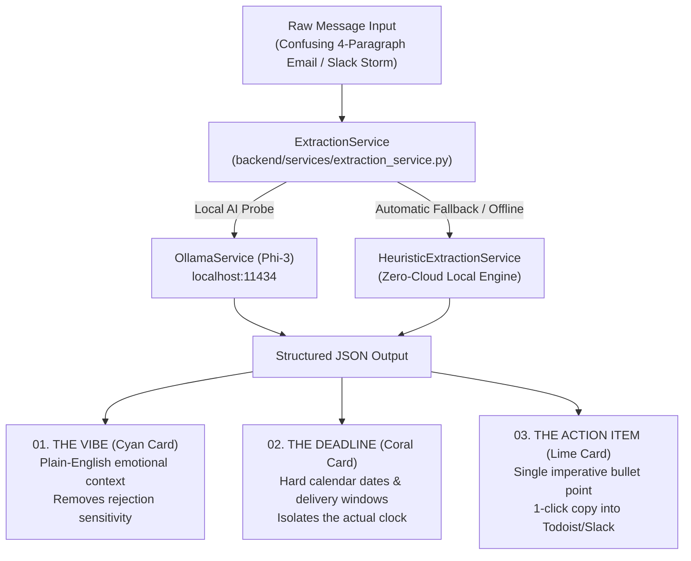

# ⚡ Focus Friend — Local-First Executive Function Assistant

> **Submission for Hacktoberfest 2026: "Build for a Friend" Challenge**  
> *Dedicated to Alex ("The Overwhelmed Professional") and everyone navigating ADHD, neurodivergence, and cognitive overload in modern work environments.*

[](https://fastapi.tiangolo.com)
[](https://www.python.org)
[](https://ollama.com)
[](LICENSE)
[](PRD.md)

---

## 🎨 Aesthetic Neo-Brutalism UI

Focus Friend is built with an unapologetic **Neo-Brutalism UI Design System**:
- **High-Contrast Geometry:** Stark black borders (`3px`/`4px`), tactile hard geometric drop shadows (`box-shadow: 5px 5px 0px #121212`), and zero blur.
- **Visual Clarity for ADHD:** Bold color-coding eliminates reading fatigue:
  - 🔵 **The Vibe (Cyan `#38BDF8`):** Emotional context & tone to disarm rejection sensitivity.
  - 🔴 **The Deadline (Coral `#FF6B6B`):** Isolates the true calendar milestone from noise.
  - 🟢 **The Action Item (Lime `#A3E635`):** Single imperative bullet point for instant task initiation.
- **Calm Micro-Interactions:** Non-startling auditory feedback synthesized entirely in-browser with the Web Audio API (warm major chords, soft click, pop) and focus-friendly breathing progress bars instead of erratic spinners.
- **Cyber-Brutalist Dark & Light Themes:** Instant toggle for users with sensory and light sensitivities.

---

## 🏗️ Clean Modular Architecture

```
Focus Friend/
├── .env.example                     # Documented environment configuration template
├── .gitignore                       # Standardized Git exclusion rules (secrets, caches)
├── LICENSE                          # MIT Open Source License
├── requirements.txt                 # Backend dependencies (fastapi, uvicorn, pydantic, etc.)
├── run.py                           # Unified application launcher (CLI flags, server, clients)
├── README.md                        # Comprehensive system & developer documentation
├── PRD.md                           # Product Requirements Document
│
├── backend/                         # Scalable Python Backend (FastAPI + Pydantic)
│   ├── main.py                      # FastAPI app entrypoint, middleware, lifespan & static mount
│   ├── config.py                    # Type-safe environment settings (Pydantic Settings / .env)
│   ├── constants.py                 # Centralized presets & prompt templates
│   ├── exceptions.py                # Structured domain exception hierarchy
│   ├── middleware/
│   │   ├── timing_middleware.py     # Request latency measurement & X-Process-Time header
│   │   └── error_handler.py         # Global domain & schema exception handlers
│   ├── api/
│   │   ├── router.py                # Main v1 API router aggregator
│   │   ├── endpoints/
│   │   │   ├── extraction.py        # POST /api/v1/extract (Distillation endpoint)
│   │   │   ├── health.py            # GET /api/v1/health (System status & engine probe)
│   │   │   ├── models.py            # GET /api/v1/models (Local models enumeration)
│   │   │   └── presets.py           # GET /api/v1/presets (Overwhelm scenario provider)
│   │   └── schemas/
│   │       ├── request_schemas.py   # Pydantic extraction request validation
│   │       └── response_schemas.py  # Structured Signal, Health, Presets & Error responses
│   ├── services/                    # Business Logic Layer (Separated from UI & API)
│   │   ├── extraction_service.py    # Primary business logic coordinator with fallback
│   │   ├── ollama_service.py        # Dedicated client for local Ollama daemon
│   │   ├── heuristic_service.py     # Zero-cloud fallback NLP distillation
│   │   └── presets_service.py       # Domain presets manager
│   └── utils/
│       └── logger.py                # Formatted console logger with configurable levels
│
├── frontend/                        # Modular Client-side Application (Vanilla ES Modules)
│   ├── index.html                   # Semantic HTML structure & accessibility tree
│   ├── css/
│   │   ├── variables.css            # Neo-Brutalist design tokens, themes, colors, shadows
│   │   ├── reset.css                # Base resets & background patterns
│   │   ├── components.css           # Neo-brutalist cards, buttons, badges, modals
│   │   └── layout.css               # Responsive layout grids & pulse animations
│   └── js/
│       ├── config.js                # Frontend config & dynamic API URL resolution
│       ├── main.js                  # Modular frontend bootstrapper & error boundary
│       ├── state/
│       │   └── store.js             # Centralized Reactive State Store (Pub/Sub & Actions)
│       ├── services/
│       │   ├── api_service.js       # Client API abstraction with retry & error handling
│       │   ├── audio_service.js     # Web Audio API calm sound synthesis
│       │   └── local_engine.js      # Zero-cloud offline heuristic distillation engine
│       ├── utils/
│       │   ├── clipboard.js         # Modular clipboard helper with non-secure fallback
│       │   ├── text_metrics.js      # Reading time & cognitive focus debt calculator
│       │   └── formatters.js        # Signal export summary plain-text generator
│       └── components/
│           ├── header_component.js  # Header, status pill, theme & sound controls
│           ├── presets_component.js # Dynamic scenario presets bar
│           ├── input_component.js   # Input buffer, metrics & keyboard shortcuts
│           ├── output_component.js  # The 3 Signal cards, copy helpers, celebration
│           ├── loader_component.js  # Calm breathing state for ADHD focus preservation
│           ├── modal_component.js   # Manifesto / shortcuts modal
│           └── toast_component.js   # Reusable toast notification system
│
├── clients/                         # Secondary Client Implementations
│   └── streamlit/
│       └── app.py                   # Accessible Streamlit dashboard client
│
└── tests/                           # Test Suite
    ├── test_services.py             # Unit tests for business logic, parsing & heuristics
    └── test_api.py                  # Integration tests for REST API endpoints & errors
```

---

## ⚡ The Signal Distillation Protocol



---

## 📡 Scalable REST API (v1)

Focus Friend includes an auto-documented OpenAPI specification accessible at `/docs`:

| Method | Endpoint | Description | Response Model |
| :--- | :--- | :--- | :--- |
| `POST` | `/api/v1/extract` | Distills raw text into Tone, Timeline, and Task | `DistilledSignalResponse` |
| `GET` | `/api/v1/health` | Inspects system health & Ollama daemon connectivity | `HealthStatusResponse` |
| `GET` | `/api/v1/models` | Lists installed local models on host machine | `ModelsResponse` |
| `GET` | `/api/v1/presets` | Retrieves standardized overwhelm scenarios | `PresetsResponse` |
| `GET` | `/api/v1/presets/{id}` | Retrieves a single scenario by key | `PresetItem` |

### Standardized Error Format
All 4xx and 5xx responses return a consistent error envelope:
```json
{
  "error": "Invalid Request Input",
  "code": "INVALID_INPUT",
  "detail": "Input text must contain at least 5 characters.",
  "timestamp": "2026-10-14T04:00:00.000000Z"
}
```

Interactive Swagger UI: **`http://localhost:8501/docs`**

---

## 🚀 Quick Start Guide

### 1. Installation
Clone the repository and install the Python dependencies:
```bash
git clone https://github.com/ezabhishek1/Focus-Friend.git
cd Focus-Friend
pip install -r requirements.txt
```

### 2. Environment Configuration
Copy the template to `.env`:
```bash
cp .env.example .env
```
Default settings run on `http://127.0.0.1:8501` with local inference enabled.

### 3. Launch the Unified Application (Web UI + REST API)
```bash
python run.py
```
Open **[http://localhost:8501](http://localhost:8501)** in your browser.

CLI Execution Options:
```bash
python run.py --port 8000       # Bind to a custom port
python run.py --reload          # Enable hot-reloading for development
python run.py --streamlit       # Launch the Streamlit dashboard client
```

### 4. Run the Test Suite
```bash
pytest -v
```

### 5. Setting up Ollama with Phi-3 (Optional for Local AI)
1. Download Ollama from [ollama.com](https://ollama.com).
2. Pull the Microsoft Phi-3 model:
```bash
ollama run phi3:mini
```
Focus Friend automatically detects the running Ollama instance and switches seamlessly from the offline engine to local Phi-3 inference.

---

## ⌨️ ADHD Keyboard Shortcuts

| Shortcut | Action |
| :--- | :--- |
| `Ctrl + Enter` (or `Cmd + Enter`) | **Extract Signal** |
| `Esc` | **Clear / Reset Input Buffer** |
| `Ctrl + Shift + C` | **Copy Distilled Action Item** |

---

## 🏆 Open Source & Privacy Guarantees

- **100% Privacy:** 0 bytes of sensitive communications leave the host machine.
- **Sovereignty:** Works completely offline without cloud vendor lock-in.
- **High Efficiency:** Microsoft Phi-3-mini (2.3GB) runs swiftly on consumer laptops.
- **Zero Account Creation:** Open, extract signal, copy action item, close app.
